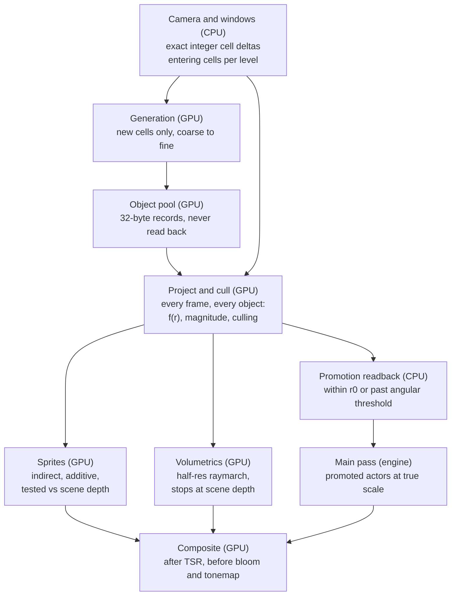

# Unified Universe — Design & Kick-off

Nov 1, 2026 · Sam Barnett · exported from the shared design doc (diagrams converted to Mermaid and a table)

## Overview and goals

Unified Universe replaces UltraLargeScale's three hand-built layers with one system: one coordinate type, one generator and one renderer, covering every scale from 2^128 cm down to 1 cm. It ships as a new plugin under the vxl umbrella, next to UltraLargeScale, so both can run A/B in the same project.

The core shift: scale is a number on each object, not a layer type, an actor class or a render pass. Most of UltraLargeScale's complexity manages the seams between layers (rebasing, spawn alignment, push timing, coordinate wrap). Unified Universe removes the seams instead.

**Goals**

- One coordinate spanning 2^128 cm (about 3.6e20 ly, roughly 4 billion observable universes) at 1 cm resolution, with no rebase and no jitter anywhere.
- One generation model. Adding a new scale (moons, rings, clusters) is data: an archetype and an emitter.
- Exact parallax and correct depth ordering between any two objects, by construction.
- A GPU-resident pipeline. Generation output is render input; the CPU only does window bookkeeping and promotion.
- Runtime sensitivity (limiting magnitude) for eye adaptation and scanner effects.
- Random-access resolve of any location, and persistence keyed by stable object identity.

**Non-goals for the first version**

- Surface and interior generation of promoted bodies (terrain, stations). Promoted actors own their own detail.
- Multiplayer and multiple simultaneous cameras.
- Positions finer than 1 cm.
- Orbital motion over time (see Risks and open questions).

## Core concepts

These terms are used with exactly these meanings throughout the specs. Type names use the `Uni` prefix.

| Term | Meaning |
| --- | --- |
| Universal coordinate (`FUniCoord`) | An absolute position: per axis, four uint32 limbs forming a 128-bit fixed-point value in cm |
| Limb | One uint32 of a coordinate axis, covering 32 bits of scale |
| Scale level L | log2 of a cell's width in cm. L = 0 is a 1 cm cell, L = 128 is the root |
| Cell | One node of the implicit octree: an address `(L, coord >> L)` |
| Window | The (2N+1)^3 cells around the camera at one level, held in toroidal slots |
| Archetype | A data asset defining one kind of object: properties, visibility, rendering, emitters |
| Emitter | A rule owned by an archetype: place child archetype X at levels L0..L1 with field F |
| Contributor | An emitter attached to a generated object, active for cells it can influence |
| Field | A density function, analytic HLSL or a baked volume, selected by ID |
| Relevance radius | Distance beyond which an object cannot be seen or matter, at baseline sensitivity. Sets its level |
| r0 | Promotion radius. Inside it, objects are actors at true scale in the main pass |
| f(r) | Radial compression applied to backdrop content beyond r0 |
| Δm | Sensitivity offset in magnitudes. Scales every relevance radius by 10^(Δm/5) |
| Backdrop | Unified Universe's own render pass for everything not promoted |

## Spec: universal coordinate

Every absolute position is an `FUniCoord`: three axes of four uint32 limbs, a 128-bit unsigned fixed-point value in cm. The root cube is \[0, 2^128) cm per axis with the nominal origin at 2^127, so all arithmetic is unsigned with no sign handling at the limb level.

```cpp
struct FUniCoord { uint32 X[4], Y[4], Z[4]; };   // limb 0 most significant, 48 bytes
// HLSL mirror: uint4 X, Y, Z
```

| Limb | Bits (cm) | Unit | One unit is roughly |
| --- | --- | --- | --- |
| 0 | 96–127 | 2^96 cm | 8.4e10 ly (the observable universe) |
| 1 | 64–95 | 2^64 cm | 19.5 ly |
| 2 | 32–63 | 2^32 cm | 43,000 km |
| 3 | 0–31 | 1 cm | 1 cm |

**Operations** (C++ in `UniCoord.h`, bit-identical HLSL in `UniCoord.ush`)

- `Sub(A, B) → FUniDelta`: per axis, a 128-bit magnitude plus sign, by limb subtraction with borrow.
- `ToDouble(FUniDelta) → FVector3d`: from the leading non-zero limb and the two after it. 96 bits covers double's 53, so this is exact to double rounding.
- `ToHiLo(FUniDelta) → {FVector3f Hi, Lo}`: Hi = float(d), Lo = float(d − Hi). This is the GPU form, accurate to about 2^-48 of |d|.
- `CellOf(Coord, L) → FUniCellKey {L, Coord >> L}`: shift across limbs. Parent is `L + 1`, child is a shift plus one octant bit.
- `Neighbour(Key, dx, dy, dz)`: ±1 at that level, wrapping at the root.
- `AddDisplacement(Coord&, Fraction&, FVector3d cm)`: splits a double displacement of any magnitude into an integer carry and a sub-cm fraction.

**The root wraps.** The universe is a 3-torus with a 2^128 cm period. This gives every operation a defined result at the edge instead of undefined casts, and the period is about 4 billion observable universes.

**Camera.** The camera is `FUniCoord` + `FVector3f Fraction` (\[0, 1) cm) + `FVector3d Velocity` (cm/s). Each tick integrates `Velocity · dt` through `AddDisplacement`. There is no rebasing and no per-layer traversal state.

**Precision guarantee.** Stored positions are exact by definition: quantization is placement, not error. Error appears only when a delta is converted to float, and it is about 1e-7 of the delta itself. Because objects of a level are compared at distances of that level's scale, the error is about 1e-7 of each object's own size, at every scale.

**Gameplay rule.** Absolute positions are never `FVector`. Any system storing a universe position uses `FUniCoord`. `FVector` is only for positions inside the real-space bubble, relative to its local anchor (see Promotion).

## Spec: scale levels and object model

An object is a 32-byte GPU record stored in its cell. Its identity, `(L, cell, index)`, never changes and keys its seed, its events and its save deltas.

**Three independent scales per object**

| Quantity | Drives |
| --- | --- |
| Relevance radius (at baseline sensitivity) | Its level, and so when it is generated |
| Luminosity / surface brightness | Sprite intensity, glare, visibility fade |
| Physical radius | Geometry, and angular-size promotion to an actor |

**Relevance radius** is the largest of three distances:

- Flux: for point sources, `R = 10 pc · 10^((m_ref − M) / 5)`, where M is absolute magnitude and m\_ref the baseline limiting magnitude.
- Angular: for extended sources, `R = R_phys / θ_min`, since surface brightness does not fall with distance.
- Influence: archetype-defined, so a star system's contributor is live wherever its planets could be relevant.

**Level assignment.** With window half-width N cells, coverage of at least N cell widths is guaranteed wherever the camera sits in the centre cell. So `L = ceil(log2(R / N))`. Level assignment always uses m\_ref, never the live sensitivity, so a scan never changes which objects exist.

**Object record** (`FUniObject`, GPU structured buffer)

| Field | Type | Bytes | Notes |
| --- | --- | --- | --- |
| Offset | uint3 | 12 | Position in the cell, units of cell width / 2^32 |
| ArchetypeId + Flags | uint16 + uint16 | 4 | Flags: promoted, delta-hidden, has-contributor |
| Seed | uint32 | 4 | Per-object seed for property draws |
| PhysRadiusLog2 | float | 4 | log2 of radius in cm |
| AbsMag, SurfaceBrightness | half × 2 | 4 | Magnitudes |
| Colour | uint32 | 4 | Packed RGB 10:10:10 |

The cell an object belongs to comes from its pool range, not the record. Window slot tables map pool ranges to cell keys.

**Identity.** `FUniObjectId` is the exact tuple `(L, cell limbs, index)` for persistence, plus a 64-bit hash for maps and GPU lookup. Indices from 2^15 upward are reserved for authored anchors so they can never collide with generated objects.

## Spec: level windows and streaming

Each active level keeps a (2N+1)^3 window of cells around the camera, with N = 2 by default (125 cells), scaled by sensitivity. This is UltraLargeScale's toroidal tier window, generalised to every level and made automatic.

**Per-level state**

- Centre cell key, and a slot table: cell key, pool range, object count and status per slot.
- Status: Pending → Generated, or Cached when restored from the cell cache.
- Slot addressing: `SlotOf(coord) = PosMod per axis` over the window side, unchanged from `FTierStreamingSystem`.

**Activation.** Level L is active only when at least one contributor emitting at L overlaps the window. Empty deep levels, such as planet levels in intergalactic space, cost nothing.

**Ordering.** Entering cells are generated coarse to fine. A cell at L waits until its parent window at L + 1 has generated. The parent window always contains a cell's parent and its loose neighbours, because the coarser window is twice as wide. A teleport rebuilds coarse to fine over several frames; deep levels fill in last.

**Velocity LOD.** A level whose cells the camera crosses faster than once every K frames (default K = 4) is suspended. It stops generating, keeps its contents, and fades its sprites. It resumes when speed drops.

**Cell cache.** Objects of an exiting cell stay in the GPU pool, marked cold, until evicted by LRU. Re-entry remaps the range instead of regenerating it. Generation is deterministic, so eviction only costs time, never content.

**Budgets and degradation**

- Global object pool: 2M objects (64 MB) to start, tuned in M2.
- Soft cap per level; caps are set per archetype mix during tuning.
- When over budget, degrade in this order: (1) pull sensitivity back toward Δm = 0, (2) suspend the deepest levels, (3) truncate per-cell counts and log it.

## Spec: generation

Content is described by archetypes that own emitters. Generating a cell means evaluating every contributor that emits at its level, Poisson-sampling a count from the field's integral over the cell, and placing that many objects. This is the main authoring surface of the system.

**Archetype** (`UUniArchetype`, data asset)

- Stable `ArchetypeId`, assigned once and never reused.
- Property distributions: absolute magnitude, physical radius, colour temperature and archetype-specific values. Each is authored as a curve and baked to a LUT.
- Visibility model: point source, extended, or both, plus θ\_min and the influence-radius rule.
- Render profile: sprite profile, optional volumetric asset, promoted actor class.
- Emitters.

**Emitter** (struct on an archetype)

- Child archetype.
- Total count: expected children per parent, for example 2e11 stars per galaxy. The field gives only the shape.
- Field: field ID, parameter block, optional baked volume.
- Influence radius, in multiples of the parent's physical radius. Bounds the contributor overlap test.
- Level range: derived from the child's relevance distribution, or set explicitly.

**Luminosity slicing.** An emitter's child magnitude distribution is split across levels by relevance radius. For a cell at level L, the expected count is:

```latex
\lambda_{cell} = N_{total} \cdot P(L) \cdot \frac{\int_{cell} F}{\int_{all} F}
```

where P(L) is the fraction of children whose magnitude maps to level L. Each placed child draws its magnitude from the conditional distribution within that slice. Bright, rare objects land on coarse, sparse levels and dim, common ones on fine, dense levels, so visible counts come out right without per-tier tuning.

**Contributors**

- Created when an object whose archetype has emitters is generated.
- Each active level keeps a compact list of contributors whose influence overlaps its window. Typically there are few: the camera is inside only a handful of galaxies and systems.
- A generating cell loops over its level's list with a sphere-versus-cell test.
- The root archetype has no position and covers everything; its emitters seed the cosmic web at the top levels.

**Fields**

- An HLSL function per field type: `float UniField_<Name>(float3 p, FUniFieldParams P)`, evaluated in contributor-local normalised coordinates so precision is relative.
- Dispatched by a switch on field ID from a generated include, which avoids shader permutations.
- Each field implements `Sample(p)` and optionally `Integrate(cell)`. The default integral uses 8 jittered probes; baked volumes use their mips.
- The existing universe and galaxy density shaders port in as the first fields.

**Placement.** Count n \~ Poisson(λ) from the cell seed. Baked fields place by hierarchical descent through the mip chain, choosing child texels by mass. Analytic fields use rejection against the probed cell maximum.

**Seeds.** `CellSeed = Avalanche(hash(L, cell limbs, ArchetypeId, ContributorId, EmitterIndex))`, and each object's seed is `MixSeed(CellSeed, index)`. Property draws use named `ProcSeed` channels, as today.

**Authored content**

- Anchors (`UUniAnchor`): an object at a fixed `FUniCoord`, or relative to a resolved parent object, with property overrides and optional emitters. Inserted at its level with a reserved index.
- Suppressors: negative contributors that mask listed archetypes within a radius, for example to clear space around an anchor.

**GPU passes per generation batch**

1. Gather contributors and compute λ per cell.
2. Prefix-sum counts and allocate pool ranges.
3. Place objects and draw their properties.
4. Register new contributors for finer levels.
5. Apply persistence deltas (hide removed objects, apply overrides).

## Spec: baked field assets

Expensive structure is simulated offline in the noise baker and sampled at runtime as tiling volume textures. Field evaluation becomes texture fetches, which leaves budget for larger windows and higher sensitivity.

**Asset types**

- `UUniFieldVolume`: a periodic 3D texture with a full mip chain. Channel 0 is density; optional extra channels carry temperature, metallicity or type mix. Default 256^3 R16F, about 38 MB with mips.
- `UUniLUT`: a 1D bake of an authored curve, as a PDF, CDF or inverse CDF. This replaces the exponent-only distributions forced on today's GPU path.

**Bake candidates**: cosmic web (Zel'dovich or adhesion approximation, or a short periodic N-body run), galaxy morphology volumes, nebula density, star cluster profiles, ring and belt profiles.

**Exact tiling lookup.** Root-level fields sample at `((cell coord mod P) + offset) / P`, where P is the period in cells at that level. The modulo is integer and exact, so lookups stay correct at 10^38 cm. This replaces `WrapGridAxis` with a principled rule.

**Tile symmetry hashing.** Each tile at level L gets one of the 48 cube symmetries (axis permutation plus sign flips) and an integer offset, chosen by `hash(L, tile coord, field ID)`. The volume must be baked periodic. This hides the period, and is why levels above 96 still have variety.

**Multi-scale reuse.** One volume can be sampled at several levels, each with its own tile transform, and combined as the field definition specifies. Self-similar structure is then one asset rather than one per scale.

**Mips are integrals.** A mip texel is the mean of its footprint, so a cell's integral is one fetch at the matching mip. The mip chain also serves as the hierarchy for placement by descent.

**Import.** An editor-module factory imports the baker's output into `UUniFieldVolume`. The exact export format is an open question for the baker.

## Spec: rendering

Everything not promoted renders in one backdrop pass with radial compression, occlusion-tested against the main scene's true-scale depth. Ordering is correct between any two objects at any distance, and engine features that assume real distances (fog, DOF, shadows, Lumen, reflections) never see compressed content.



Only two things cross back to the CPU: promotion candidates and event readbacks. Object data stays on the GPU from generation through to the composite.

**Radial compression.** Scaling anything about the eye leaves its projection unchanged: position, angular size and angular motion are preserved. So any monotonic f is visually free, and parallax is exact by construction.

```latex
f(r) = \begin{cases} r & r \le r_0 \\ r_0 \left(1 + \ln \frac{r}{r_0}\right) & r > r_0 \end{cases} \qquad p_{render} = \hat{d} \cdot f(r), \quad s_{render} = s \cdot \frac{f(r)}{r}
```

f is C1-continuous at r0. With r0 = 1e9 cm, the whole 2^128 cm range fits inside about 69 r0 of render space.

**Per-cell relative vectors (CPU, every frame).** For each resident cell, compute `ToHiLo(Sub(CellOrigin, Camera))` in exact integer arithmetic. That is about 10k cells and a 240 KB upload, so it is negligible.

**Project and cull (compute, every frame, all resident objects)**

1. Relative vector = Hi + (Lo + Offset · cellWidth / 2^32), then r.
2. Apparent magnitude m = M + 5 log10(r / 10 pc). Cull when m is past m\_lim plus the fade band, outside the frustum, promoted, or delta-hidden.
3. Emit a sprite instance: render position, angular radius (minimum pixel footprint plus glare growth with flux), intensity from m and exposure, colour.
4. Emit volumetric proxies for extended objects in view.
5. Append promotion candidates to a readback buffer (see Promotion).

**Sprites.** One instanced indirect draw for every point source at every level. Additive, full output resolution. The pixel shader converts main-scene depth to true distance and discards when the scene surface is nearer. That gives correct occlusion by promoted bodies without a per-pixel sprite depth.

**Volumetrics.** A proxy box per extended object, placed with f. Raymarching runs in object-local normalised coordinates from the exact camera-local position, and stops at the main-scene surface distance.

- Render at half or quarter resolution with a scene-depth-aware upsample.
- Beyond a distance threshold, refresh every N frames and reproject using camera rotation only.
- v1 composites volumetrics over sprites without interleaving, as today. v2 stores transmittance at a few log-distance slices so sprites inside a nebula are attenuated correctly.

**Frame placement**

- Backdrop render: after the base pass, because it needs scene depth.
- Composite: after TSR and before bloom and tonemapping, so sub-pixel stars are not smeared but still get bloom and auto-exposure. A post-processing subscription after motion blur should land there; check the pass order in the target engine version.
- Inside a planetary atmosphere, the composite applies the atmosphere's transmittance LUT so stars fade with haze and daylight.

**Sky lighting.** Periodically capture the backdrop into the sky light's cubemap, so promoted objects are ambient-lit by and reflect the actual galaxy around them.

**Integration.** A `FSceneViewExtensionBase` subclass owns all passes, built with the render graph. No SceneCapture and no Niagara.

## Spec: promotion and the real-space bubble

An object is promoted to a pooled actor at true scale in the main pass when its near surface comes within r0 or its angular size passes θ\_promote. r0 defaults to 1e9 cm (10,000 km), so a planet you approach is fully real before you reach it.

**Criteria, with hysteresis**

- Promote when `r − R_phys < r0` or `R_phys / r > θ_promote`.
- Demote at 1.25× both thresholds, so objects near the boundary do not flicker between states.

**Handoff without a gap**

1. Project and cull appends candidates to a readback buffer, with 1–2 frames of latency.
2. The object keeps drawing in the backdrop while its actor is acquired from the pool and initialised.
3. On the frame the actor is ready, the pool record's promoted flag is set and the actor becomes visible together. This is the same deferred-placement idea as UltraLargeScale's `bPendingPlacement`.

**Local anchor.** The main scene uses a local anchor `FUniCoord`. A promoted object's world location is `ToDouble(Sub(ObjectCoord, Anchor))`, and the camera is `Anchor + PawnLocation`. Unlike UltraLargeScale, the pawn moves normally, which keeps physics and gameplay conventional.

**Two motion modes**

| Mode | When | Behaviour |
| --- | --- | --- |
| Local | Below cruise speed | The pawn moves in the main scene. The anchor re-centres when the pawn is more than 1e8 cm from the origin, shifting promoted actors once |
| Cruise | Above cruise speed | The pawn is pinned. Camera velocity integrates into `FUniCoord` directly, and the anchor follows the camera every frame |

**Lighting.** Each promoted group gets a light rig from the 1–2 brightest nearby luminous objects. Direction and intensity come from exact coordinates and flux, never from render-space positions. Shadows exist only between promoted actors.

**Detail beyond this system.** A promoted actor's archetype class owns its own detail (surface, atmosphere, stations), keyed by the object's seed. Unified Universe's responsibility ends at placement, lighting inputs and lifecycle events.

## Spec: sensitivity

Sensitivity is one runtime value, Δm, a limiting-magnitude offset from baseline. It scales every relevance radius by the same factor, so it acts per level without touching any object.

```latex
k = 10^{\Delta m / 5}, \qquad N_L = \lceil N \cdot k \rceil, \qquad m_{lim} = m_{ref} + \Delta m, \qquad \mu_{lim} = \mu_{ref} + \Delta m
```

- **Windows** grow from N to ⌈N·k⌉ cells per level, capped at N\_max = 6 (13^3 cells).
- **Fade.** Sprite intensity reaches zero across \[m\_lim − 0.5, m\_lim\]. Objects therefore stream in and out exactly where they are already invisible, which hides pop-in by construction.
- **Extended sources** use the same offset on a surface-brightness limit μ, so a sensitive scan also brings up faint dwarf galaxies and dim nebulae.
- **Determinism.** Level assignment uses m\_ref only. A scan never changes which objects exist, only which are resident and visible.
- **Range.** Δm is clamped to \[−5, +5\] by default. Residency grows with k^3, and Δm = +3.5 is already about 125× the volume.

**Shapes**

| Shape | Behaviour |
| --- | --- |
| Global | One Δm everywhere |
| Ping (expanding shell) | Boosted Δm inside a shell growing outward from the camera. Far objects reveal later, so generation streams ahead of the shell and its latency is hidden |
| Cone | Boosted Δm within an angle of a direction. Windows expand only in cells that intersect the cone, so cost scales with the cone's share of the sky |

**Adaptation.** Δm can be driven by local brightness through the auto-exposure value. Near a star or inside a bright nebula, fewer distant stars are visible, as in daylight. Resident counts also shrink where the local scene is most expensive.

## Spec: runtime API

Gameplay and tools reach the system through one world subsystem, `UUniSubsystem`. Nothing outside the plugin touches GPU buffers or window state directly.

| Area | API | Notes |
| --- | --- | --- |
| Camera | `SetCamera`, `Teleport`, `SetVelocity`, `GetMotionMode` | Teleport triggers the coarse-to-fine rebuild |
| Resolve | `ResolveCell(FUniCellKey)`, `ResolveObject(FUniObjectId)` | Async. Generates the ancestor chain (one cell per level) on demand, anywhere. For maps, nav and lookups |
| Query | `QueryResident(Centre, Radius, Filter)`, `FindNearest(Archetype, From)` | Resident set only; use Resolve for anywhere else |
| Pick | `Pick(ScreenPos)` | Object ID from the brightest sprite under the cursor, via an ID buffer readback |
| Events | `OnResident`, `OnVisible`, `OnPromoted`, `OnDemoted` | Batched once per frame from readbacks. Gameplay subscribes instead of polling |
| Sensitivity | `SetSensitivity(Δm)`, `StartPing(...)`, `SetConeScan(...)` | See Sensitivity |
| Persistence | `UUniDeltaStore`: `Remove`, `Override`, `MarkDiscovered`, `Rename` | Keyed by `FUniObjectId`, saved with the game. A GPU mirror feeds the delta pass |
| Readouts | `UniScaleLadder` | Ported from `ULSScaleLadder`, fed from exact deltas |

**Blueprint exposure.** `FUniCoord`, `FUniCellKey` and `FUniObjectId` are BlueprintTypes. They serialise to a hex string and come with helpers for distance (as double cm) and formatting through the scale ladder.

## Plugin structure

The plugin is `UnifiedUniverse`, with four modules and a shader directory mapped to `/Plugin/UnifiedUniverse`. It has no dependency on UltraLargeScale, so the A/B never couples the two.

| Module | Type | Loading phase | Owns |
| --- | --- | --- | --- |
| UnifiedUniverseCore | Runtime | Default | `FUniCoord` and maths, cell keys, `UniSeed` (ported `ProcSeed`), archetype, emitter, anchor and field assets, `UUniDeltaStore`, CPU resolve |
| UnifiedUniverseRender | Runtime | PostConfigInit | Shader directory mapping, scene view extension, generation and render RDG passes, GPU buffers |
| UnifiedUniverse | Runtime | Default | `UUniSubsystem`, windows, promotion, actor pool, local anchor, motion modes, events |
| UnifiedUniverseEditor | Editor | Default | Baker asset import, archetype validation (no emitter cycles, child levels strictly finer), debug views |

**Shaders**

| File | Contents |
| --- | --- |
| `UniCoord.ush` | Limb maths, mirrors `UniCoord.h` bit for bit |
| `UniSeed.ush` | Avalanche, MixSeed, channel IDs |
| `UniFields.ush` + generated `UniFieldRegistry.ush` | Field functions and the ID switch |
| `UniGen.usf` | Gather, allocate, place, register contributors, apply deltas |
| `UniProject.usf` | Project and cull |
| `UniSprite.usf` | Sprite vertex and pixel shaders |
| `UniVolume.usf` | Volumetric raymarch and upsample |
| `UniComposite.usf` | Composite and atmosphere transmittance |

**Carried over from UltraLargeScale.** These are copied rather than shared, to keep the A/B independent. Shared pieces can move into a common vxl core plugin once one approach wins.

| From UltraLargeScale | Becomes |
| --- | --- |
| `ProcSeed` (ProceduralSpaceActor.h) | `UniSeed` |
| Toroidal addressing in `FTierStreamingSystem` | Level window slot maths |
| `UniverseDensityCore.ush`, `GalaxyDensityCore.ush` | The first fields |
| `ULSScaleLadder` | `UniScaleLadder` |
| `ActorPoolManager`, `IPooledActor` | The promotion actor pool |

**Retired, with no equivalent:** per-layer actors and their `UnitScale` / `SpeedScale` / virtual-traversal parallax, the SceneCapture backdrop, the pointer `FOctree` and its rebase, `ComputeChildSpawnLocation`, per-tier Niagara components, and `WrapGridAxis`.

## Comparison with UltraLargeScale and A/B plan

Unified Universe wins on structure: it removes the seams UltraLargeScale manages. UltraLargeScale wins on maturity: it works, it's tuned, and it's debugged.

|  | UltraLargeScale (3 layers) | Unified Universe |
| --- | --- | --- |
| Precision | Per-layer frames, octree rebase, `WrapGridAxis`, jitter guards | Exact integer deltas, about 1e-7 of each object's own scale |
| Depth ordering | Fixed layer compositing; wrong inside a structure, hidden by additive blending | Monotonic f plus a scene-depth test; correct between any two objects |
| Parallax | Per-layer rates and `SpeedScale` / `UnitScale` coupling | Exact by construction, nothing to tune |
| Transitions | Layer handoffs: child spawn alignment, pool timing, pop risk | None. An object changes how it draws, never which system owns it |
| Adding a scale | New actor class, tiers and Niagara assets | An archetype and an emitter |
| Visible counts | Hand-tuned per tier | From luminosity functions and sensitivity |
| CPU cost | Array marshalling and Niagara pushes per tier | Window bookkeeping and promotion readback only |
| Maps, nav, saves | Content exists only where streamed | Random-access resolve, identity-keyed deltas |
| Authoring tools | Niagara editor and debugger | Own debug views, to be built |
| Maturity | Working, tuned, debugged | New |

**A/B setup.** Both plugins load in the same project. Each has its own test map, and a shared comparison map has a toggle actor that spawns one or the other. Content won't match object for object, so comparisons use matched scenes and technical metrics.

**Metrics**

- GPU time: generation, project and cull, backdrop, composite.
- Game-thread CPU time and memory.
- Jitter: frame-to-frame screen-space movement of static objects with the camera parked at far coordinates (10^30 cm and above).
- Handoff pops counted along a scripted flythrough from supercluster scale down to an asteroid.
- Visible star counts against the luminosity-function expectation.
- Authoring time to add one new scale (for example, moons).

## Kick-off

Work proceeds in five milestones, each closed by a gate that proves one risk is retired. Rendering integration comes first: it is the largest unknown, and it can be tested without any hierarchy.

| Milestone | Scope | Exit gate |
| --- | --- | --- |
| M0 Foundations | Plugin, modules, FUniCoord in C++ and HLSL, seed port, A/B comparison map | Coordinate tests pass: borrow, wrap, shifts, hi/lo; CPU and GPU results bit-identical |
| **M1 Render spine** | One baked field, one level, no hierarchy; project and cull, sprites, composite | No jitter from 10^30 cm down to 1 m; correct occlusion by a promoted mesh; 1M objects within the GPU budget |
| M2 Generation | Level windows, archetypes, emitters, contributors; galaxy to star, baked cosmic web field | Revisits regenerate identically; counts match expectation; dependency latency measured |
| M3 Promotion and real space | r0 bubble, local anchor, motion modes, handoff, lighting rig, events | Approach and promote a planet with no pop; physics stable in Local mode |
| M4 Volumetrics, sensitivity, tools | Half-res volumetrics, sensitivity and ping, deltas, resolve API, debug views | A/B review against UltraLargeScale on the agreed metrics |

Each milestone builds only on gates already passed. If M1 runs into a wall with the engine's render hooks, it surfaces before any generation work depends on it.

**First tasks (M0)**

- [ ] Create the `UnifiedUniverse` plugin with its four modules and shader directory mapping.
- [ ] Implement `FUniCoord`, `FUniDelta`, `FUniCellKey` and their operations in `UniCoord.h`.
- [ ] Mirror them in `UniCoord.ush` and add a CPU/GPU parity test dispatch.
- [ ] Unit tests: borrow chains, root wrap, level shifts, hi/lo conversion, `AddDisplacement` at extreme magnitudes.
- [ ] Port `ProcSeed` to `UniSeed`, in C++ and HLSL.
- [ ] Stub the scene view extension and draw one test sprite through the backdrop and composite.
- [ ] Agree the noise baker's export format for periodic volumes.
- [ ] Build the A/B comparison map with its toggle actor.

## Risks and open questions

The biggest risk is rendering integration, which is why M1 tackles it first.

| Risk | Impact | Mitigation |
| --- | --- | --- |
| Scene view extension hooks shift between engine versions | Backdrop or composite breaks on an upgrade | Keep all hook code in one file; M1 proves the hooks on the target version |
| Rewrite cost and lost tuning | Months before visual parity with UltraLargeScale | Port fields first; keep UltraLargeScale as the reference |
| A generic field vocabulary limits art direction | Harder to get bespoke looks | Fields are arbitrary HLSL; a custom look is one function away |
| Dependency latency across levels | Deep levels fill in late after teleports or sensitivity spikes | Coarse-to-fine progressive fill; ping shapes hide it |
| Absolute positions leak into `FVector` gameplay code | Precision bugs far from origin | Gameplay rule in the coordinate spec; code review checklist |
| Residency spikes with sensitivity | Over budget at high Δm | Hard caps and the degradation order |

**Open questions**

- [ ] Naming: is the `Uni` type prefix and the four-module split right for the vxl umbrella?
- [ ] Noise baker: what is its export format, and can it bake periodic volumes for cube-symmetry tiling?
- [ ] Orbits: static placement, or deterministic Kepler motion from seed plus time? This affects whether identity maps to a fixed position.
- [ ] Contributor gather: is a per-level list enough, or does it need a spatial hash past about 256 contributors per level?
- [ ] Object pool size and per-level caps, set during M2 tuning.
- [ ] Target engine version, which fixes the exact post-processing subscription point.
- [ ] Is a 1 cm floor enough, or do any systems need a fifth, sub-cm limb?

## Appendix A: inherited lessons from UltraLargeScale

Unified Universe keeps none of UltraLargeScale's architecture, but it inherits these rules. Each one cost a debugging session in UltraLargeScale, and each would plausibly recur here. The source column names where the lesson is documented, so the original reasoning stays one click away.

**Fields and generation**

| # | Rule for Unified Universe | Source | Constrains |
| --- | --- | --- | --- |
| 1 | Render and placement evaluate the identical field function with identical inputs. No CPU stand-in: the C++ shim stubs texture fetches to 0.5, which changes geometry, not just quality. Generation fails closed instead of falling back. | `UniverseDataGenerator.h`, `GalaxyDataGenerator.h` | Generation, Rendering |
| 2 | Field parameters have one marshal site (`Pack`), and derivation runs in the shader from raw inputs. Never upload a derived struct as a constant buffer mirroring the C++ layout: one straddling float3 shifts every field after it, silently. | `FUniverseDensityArgs`, `FGalaxyDensityArgs` | Generation, Baked field assets |
| 3 | A field's textures are an all-or-nothing bundle, resolved once and handed to both consumers. A missing texture changes the field's geometry, so partial sets are rejected, never degraded. | `FUniverseFieldTextures`, `FGalaxyFieldTextures` | Baked field assets |
| 4 | Volumes read by compute are set to Never Stream; the material handles residency and a dispatch does not. Unified Universe reads mips for integrals, so the whole chain must be resident. | `FGalaxyProceduralParams` texture notes | Baked field assets |
| 5 | Sampler addressing in the dispatch must match each asset's saved addressing, or the two paths diverge at the wrap only. Warp volumes must be signed \[-1, 1\]; a UNORM warp translates the field instead of displacing it. | `UniverseEntityGen.cpp`, `GalaxyParams.h` | Baked field assets |
| 6 | Texture scale numerators over the wrap period must be pairwise coprime (use primes), or the field re-aligns as a visible grid. The period must also be a multiple of both the wrap alignment and the lattice ratio. | `FUniverseRegionParams`, `UniverseCellWrap` | Baked field assets (tile hashing, multi-scale reuse) |
| 7 | Domain warp shear is amount × scale × the asset's gradient, and above 1 the field tears. Swapping a warp asset silently retunes geometry, so check predicted shear on every asset change. | `PredictedFoldShear` | Baked field assets |
| 8 | After count normalisation, a field's absolute magnitude is unobservable: density multipliers cannot change counts. Counts need an explicit knob, which is `N_total` on the emitter; fields are shapes only. | `StarDensityScale`, `kBudgetAnchor` | Generation |
| 9 | Calibrate unbounded fields on a scattered sample across many field cells, not a contiguous block, and divide by a high percentile (0.98), not the maximum. A block-sized sample made the Small tier over-deliver by two orders of magnitude. | `kCalibrationParents`, `kCalibrationPercentile` | Generation (cell integrals) |
| 10 | A rejection envelope taken over too large a cell saturates acceptance, so dense regions under-deliver and arms come out holed. Thin-filament fields need more probes: one round of 64 under-estimated peaks by 10×. | `FGalaxyConfigParams` notes, `ProbesPerCell` | Generation (placement) |
| 11 | The placement key stays unwrapped even when the field repeats, so content stays aperiodic. Only the field lookup wraps. | `FUniverseGenCell::Coord` | Generation (seeds), Baked field assets |
| 12 | Fades belong to the render, never to placement; otherwise content depends on where the player stood when a cell generated. This applies to the sensitivity fade too. | `BoundsFadeStart` notes | Generation, Sensitivity |
| 13 | Expensive field layers early-out when their density is zero. Do not tidy those guards into a lerp or max; the early-out is what makes simple archetypes cheap. | `UGalaxyArchetype` notes | Generation (fields) |

**Archetypes and seeds**

| # | Rule for Unified Universe | Source | Constrains |
| --- | --- | --- | --- |
| 14 | Seed channels: add, never reuse or repurpose. Rolled parameters key their stream by name, uppercased first because FName comparison is case-insensitive. Each categorical bag gets its own channel, so bags multiply rather than lock together. | `GalaxySeed`, `ProcSeed::ChannelId(FName)` | Generation (seeds) |
| 15 | Keep the archetype pipeline order fixed: exemplar, then ranges (Min, Max, Bias, Quantize), then bags, then a bespoke logic hook last. Counts need Quantize. Validate catches Min > Max, which otherwise produces silent garbage. | `UGalaxyArchetype::Resolve`, `FGalaxyParamRange` | Generation (archetype data model) |
| 16 | Keep a defaults-only mode that returns the exemplar verbatim. Toggling it isolates what generation changed, which is the comparison A/B work needs. | `FGalaxySpawnConfig::bUseDefaults` | Generation, A/B plan |
| 17 | Split rolled parameters from never-rolled config. Anything that sizes a buffer must not vary per instance, because buffers are pooled. | `FGalaxyConfigParams` | Generation, Level windows |
| 18 | Nested USTRUCTs ignore `Category` in the details panel, so group authoring parameters with sub-structs. A plain struct between `USTRUCT()` and its struct steals the macro. | `GalaxyParams.h` header notes | Generation (authoring UX), Plugin structure |

**GPU dispatch and threading**

| # | Rule for Unified Universe | Source | Constrains |
| --- | --- | --- | --- |
| 19 | Absolute positions never reach the GPU as float. Pass a cell as integer plus fraction: an absolute centre collapses every probe onto one float and the tier silently places nothing. | `FUniverseGenCell` | Universal coordinate, Generation |
| 20 | GPU structs are flat multiples of 16 bytes with no straddling float3, guarded by `static_assert`. Float data rides integer buffers as bit patterns. | `FUniverseEntityOut`, `FUniverseGenCell` | Scale levels and object model |
| 21 | Compaction by global atomic makes storage order nondeterministic. Identity comes from the candidate index, never buffer position. Keep allocation headroom (9/8), because truncation by arrival order is nondeterministic and spatially biased. | `FUniverseEntityOut::Slot`, `GalaxyDataGenerator.cpp` | Scale levels and object model, Generation |
| 22 | Counter and buffer layouts are defined in one place, with every size derived from them. RDG buffer pooling hides an undersized buffer until an unrelated out-of-bounds assert. | `UniverseEntityGen::CountersPerCell` | Generation, Level windows |
| 23 | Dispatches are capped at 65,535 groups per dimension; wrap into 2D. Exceeding it means no dispatch and a readback timeout, with nothing naming the cause. Project and cull over millions of objects hits this first. | `UniverseEntityGen.cpp` | Generation, Rendering |
| 24 | Readbacks: allocate on the calling thread, enqueue render commands from the game thread, call `Lock()` only on the render thread, and keep a 2 s timeout as a safety valve. Never block the game or render thread on GPU work. | `FUniverseEntityGenRequest`, `UniverseEntityGen.cpp` | Generation, Promotion, Runtime API |
| 25 | Capture everything a render command needs in one payload, by value. Nested `[=]` captures across two thread hops can move an array twice, leaving a zero-cell dispatch that silently writes nothing. | `UniverseEntityGen.cpp` | Generation, Rendering |
| 26 | Weak texture pointers expire individually. Re-check every one at dispatch time, not just when the request was made. | `UniverseEntityGen.cpp` | Baked field assets |
| 27 | A reused slot or pool range that a failed batch did not write must be blanked. Otherwise the previous occupant's content shows at the new cell. | `GenerateTierBatchGPU` | Level windows (cell cache) |
| 28 | Cached calibration must be cleared whenever its inputs change. In UltraLargeScale that bit pooled actors; in Unified Universe, key caches by archetype version. | `GalaxyDataGenerator::Initialize` | Generation |

**Pooling, assets and modules**

| # | Rule for Unified Universe | Source | Constrains |
| --- | --- | --- | --- |
| 29 | Acquire from a pool by the same token that registered it. A class-key mismatch silently degrades into spawn-per-acquire; the tell is the registered class's inert count stuck at its prewarm value. | `UActorPoolManager::Acquire` | Promotion |
| 30 | Defaults written in a constructor are lost when reinit assigns params wholesale. Substitute defaults at initialisation instead. | `FGalaxyProceduralParams` notes | Promotion |
| 31 | A promoted actor inherits its sprite's orientation and appearance, so nothing snaps on handoff. | `bInheritParticleOrientation` | Promotion |
| 32 | Asset paths stored as strings are invisible to the cooker. Use full `Package.Object` paths with a cooked reference, and remember a disabled content plugin returns null with no error. | `FUniverseMaterialParams` asset notes | Baked field assets, Plugin structure |
| 33 | Guard shader directory mapping against double registration, because live coding re-runs `StartupModule`. | `FUltraLargeScaleModule::StartupModule` | Plugin structure |
| 34 | A derivation mirrored in C++ and HLSL must agree bit for bit; float versus double rounding can disagree on half boundaries. Integer arithmetic avoids the issue, which is why `UniCoord` is integer-only. | `UniverseCellWrap` | Universal coordinate |

**Rendering**

| # | Rule for Unified Universe | Source | Constrains |
| --- | --- | --- | --- |
| 35 | Step volumetric marches along the chord with growth, not by camera distance. Camera-distance steps collapse when the camera is inside the volume. Set the step budget explicitly, because a truncated march looks finished. | `FUniverseMaterialParams`, `FGalaxyMaterialParams` | Rendering (volumetrics) |
| 36 | Sprite intensities authored for a tonemapped path over-bloom once composited before bloom. Sprite brightness needs to be in exposure-calibrated units from the start. | `BackdropIntensity` notes | Rendering, Sensitivity |
| 37 | Keep a debug mode that colours entities by sampled density. It separates "placement and render disagree about position" from "bad distribution", which look identical otherwise. | `bDebugColorByDensity` | Rendering (debug views, M4) |

**Coverage.** I read the universe, galaxy and star-system headers, the pool manager, the parallax proxy and the module source in full. The remaining `.cpp` bodies and shaders were covered by targeted search, not a line-by-line read, so a few lessons buried in shader bodies may still be missing.

## Appendix B: UltraLargeScale baseline values

These are UltraLargeScale's tuned defaults as authored in code. They define visual parity for the A/B, not design inputs for Unified Universe. Values on placed actors or archetype assets may differ from these code defaults, so capture the live values from the comparison map alongside screenshots.

One caveat for comparisons: UltraLargeScale's star-system scales are about three orders of magnitude below real scale (a code TODO says so), while Unified Universe uses real cm throughout. Compare star-system scenes by look and counts, not by size.

**Universe layer** (`UniverseParams.h`, `UniverseEntityGen.h`, `UniverseActor.h`)

| Parameter | Value | Meaning |
| --- | --- | --- |
| Seed | 69 | Universe root seed |
| UnitScale | 1.6e17 | Real cm per universe-local unit |
| MaxEntityScale | 1e22 cm | Largest galaxy; tiers cascade down from it |
| Tier GridDepth (L / M / S) | 1 / 3 / 5 | Spacing 2, so 4× scale per tier and 64× total spread |
| Tier SlotCapacity (L / M / S) | 1000 / 500 / 500 | Per-slot target and buffer size |
| Tier NeighborhoodRadius | 1 | 3×3×3 windows |
| GenerationSubdivision (L / M / S) | 2 / 1 / 1 | Sized against the field cell |
| Tier scale ranges | L 2.5e21–1e22, M 6.25e20–2.5e21, S 1.5625e20–6.25e20 cm | Derived from MaxEntityScale |
| Lattice CellSizeSmall / Large | 0.3 / 0.9 | Ratio exactly 3 |
| Wall Density | 0–1, bias 6 | Region-varying range |
| Wall Falloff | 2–12, bias 1 | The void-fraction lever |
| Filament Density | 0.5–1.5, bias 0.5 |  |
| Void Floor | 0–0.5, bias 8 | Never below zero |
| Void SizeSpread | 0–0.5, bias 2 | Squared cell units |
| FeatureWidth | 0.1–0.4, bias 2 | Small cells; also floors march step |
| Warp large: amount / scale | 0.333–1.333 / 0.099854 (409/4096) | Bends the web |
| Warp small: amount / scale / follow | 0.05–0.3 bias 2 / 0.751730 (3079/4096) / 0 | About 94% of predicted shear |
| Region scales: structure / appearance | 0.004639 (19/4096) / 0.010010 (41/4096) | Prime numerators |
| Field volumes | `VT_MultiNoise_1_S8`, `VT_MultiNoise_2_S8` (256³); `VT_PerlinVector_S4`, `VT_PerlinCurl_S4` (128³) | In `/UniverseNoisePack` |
| March step budget / growth | 128 / 4 | About 51 effective steps |
| Probes per cell | 128 | Two rounds of 64 |
| Calibration | 96 parents, 8 field-cell span, 0.98 percentile |  |
| SpawnScreenSpaceThreshold | 0.0018 | Angular size that triggers a child spawn |
| BackdropDepthThreshold | 1e9 cm | Scene depth treated as sky |
| Pool prewarm: galaxy / system / planet | 5 / 5 / 5 | Central pool |

**Galaxy layer** (`GalaxyParams.h`)

| Parameter | Value | Meaning |
| --- | --- | --- |
| UnitScale | 2.4e13 | Milky-Way-class galaxy maps to about 5.2e9 local units |
| Star-system MaxEntityScale | 1e16 cm | About three orders under real scale |
| Tier GridDepth / radius / capacity / subdivision | L 1 / 0 / 6000 / 3; M 3 / 1 / 8000 / 1; S 5 / 1 / 6000 / 1 | Large is one exhaustive cell |
| March step budget / growth | 192 / 2 | About 105 effective steps |
| Arms | count 16, pitch 25°, radius 0.75, density 1, noise 0.333, warp 0.025 | Code-default exemplar |
| Disc | radius 0.7, vertical ratio 0.01, density 0.5, scale ratio 2, flare 10.18, warp twist 2.28 |  |
| Bulge | radius 0.33, vertical ratio 0.6, density 3, concentration 1 |  |
| Background | vertical ratio 0.5, density 0.1, bounds fade start 0.33 |  |
| Central void | radius 0.033, amount 1, exponent 1 |  |
| Noise channel weights | (−1, −0.7, −0.4, −0.4) |  |

**Star-system layer** (`StarSystemParams.h`)

| Parameter | Value | Meaning |
| --- | --- | --- |
| UnitScale | 1.2e7 |  |
| Max planets | 8 | Line layout |
| Terrestrial / gas giant radius | 1e8–1e9 / 3e9–2e10 cm | Real-scale planet sizes |
| Orbit span | 0.08–0.85 of extent | Inner to outer orbit |
| Max eccentricity / inclination | 0.2 / 8° |  |
| Belt: radius / width / thickness | 0.45 / 0.10 / 0.015 of extent | Gaussian ring |
| Dust density / thickness | 0.05 / 0.04 |  |
| Tier GridDepth / radius / capacity | L 1 / 0 / 64; M 4 / 1 / 256; S 7 / 1 / 128 |  |
